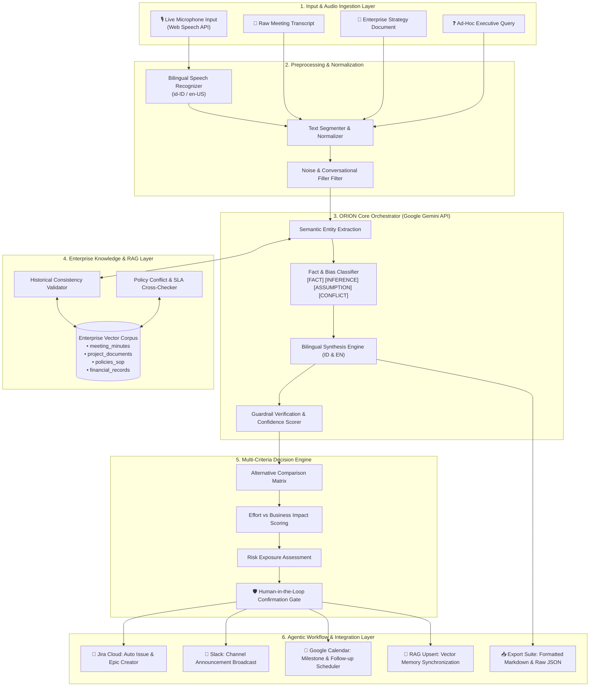

# 🌌 ORION — Enterprise Decision & Productivity Orchestrator v1.0
> **Next-Generation Bilingual (ID/EN) AI Platform for Intelligent Meeting Intelligence, Decision Matrices, and Agentic Workflow Orchestration**

[](https://react.dev/)
[](https://www.typescriptlang.org/)
[](https://ai.google.dev/)
[](https://tailwindcss.com/)
[](https://vitejs.dev/)
[](LICENSE)

---

## 📖 1. What is ORION?

**ORION** (*Enterprise Decision & Productivity Orchestrator*) is an enterprise-grade AI system designed to transform spoken meetings, strategic transcripts, unorganized notes, and business documents into **rigorous, actionable decisions** and **automated agentic workflows**.

### The Enterprise Dilemma
Organizations worldwide suffer from systematic productivity drains:
1. **Meeting Fatigue & Information Loss**: High-velocity meetings generate thousands of spoken words, yet crucial action items, owners, and hard deadlines are forgotten or inaccurately minuted.
2. **Fact vs. Assumption Ambiguity**: Corporate discussions frequently blend verifiable data with personal speculation. Without classification, assumptions are mistakenly treated as validated facts.
3. **Historical Inconsistencies & Knowledge Silos**: Teams frequently make decisions that unknowingly contradict past quarters' agreements, regulatory compliance policies, or existing SLAs because human memory fails to retrieve enterprise archives.
4. **Bilingual & Code-Switching Barriers**: In multinational teams and Southeast Asian enterprise hubs, discussions naturally switch between English and Bahasa Indonesia (*bahasa campur*), causing off-the-shelf transcription tools to misinterpret context.
5. **Execution Latency**: Generating minutes is only half the battle; translating decisions into Jira tickets, Slack announcements, calendar invites, and database syncs takes hours of manual busywork.

### The ORION Solution
ORION acts as a **central enterprise orchestrator** grounded in four key principles:
- **Zero-Hallucination Guardrails**: Strictly labels every extracted point as `[FAKTA]` (*Fact*), `[INFERENSI]` (*Inference*), `[ASUMSI]` (*Assumption*), or `[KONFLIK]` (*Conflict*).
- **Full Bilingual Parity (ID/EN)**: Native real-time understanding and translation for Bahasa Indonesia and English in dual-mode and code-switched dialogues.
- **Structured Multi-Criteria Decision Matrices**: Evaluates competing proposals based on business impact, risk exposure, resource effort, and empirical data backing, guarded by a *Human-in-the-Loop* approval gate.
- **Agentic Workflow Dispatch**: Instantly formats extracted action items into production-ready payloads for enterprise software (Jira Cloud, Slack Webhooks, Google Calendar, and Vector Knowledge Bases).

---

## 🛠️ 2. Technology Stack

ORION is engineered with a modern, reactive, ultra-low latency frontend and intelligent backend services:

| Category | Technology | Architecture & System Role |
| :--- | :--- | :--- |
| **Core AI & LLM Engine** | **Google Gemini API (`@google/genai` v2.4+)** | Contextual reasoning, semantic extraction, bias detection, multi-turn synthesis, and bilingual text generation using Google's frontier models. |
| **Speech-to-Text (STT)** | **Web Speech API (`webkitSpeechRecognition`)** | Real-time, continuous microphone speech transcription directly in the client browser with bilingual recognition (`id-ID` & `en-US`). |
| **Frontend Framework** | **React 19 (Hooks & Functional)** | Modular, component-driven UI architecture designed for zero vertical scroll on standard enterprise monitors (*Viewport Presence*). |
| **Language & Typings** | **TypeScript 7 / 5.x** | Strict static type definitions across extraction schemas, decision models, and agentic dispatch structures. |
| **Build & Tooling** | **Vite 8** | High-speed bundling, instantaneous Hot Module Replacement, and optimized production builds. |
| **Styling & Design System** | **Tailwind CSS v4 + HTML5 Canvas API** | Cyber-Enterprise Constellation theme (Dark Cyan / Deep Navy / Slate) paired with an ambient, real-time particle connection network. |
| **UI Components & Motion** | **Lucide React & Motion** | Modern iconography, fluid view transitions, and interactive progress/meter indicators. |
| **RAG & Knowledge Engine** | **Semantic Cosine Vector Simulator** | Vector similarity scoring and consistency checking across enterprise corpus collections (*meeting_minutes*, *policies_sop*, *project_documents*). |
| **Export Engine** | **Markdown & JSON Serializer** | One-click export and download for human-readable Markdown (`.md`) Minutes of Meeting and machine-readable JSON (`.json`) payloads. |

---

## 🏗️ 3. Architecture Diagrams

### 3.1 End-to-End System Architecture (Mermaid)



---

### 3.2 Data Flow & Processing Lifecycle

```
[ User Voice / Document ]
           │
           ▼  (1) Audio capture or text pasting
[ Input View & Web Speech API ]
           │
           ▼  (2) Normalized bilingual stream
[ ORION Analyzer Service ]
           ├─── (3A) Historical Cross-Reference ──> [ Vector Knowledge Base ]
           │                                                  │ (Retrieve SOP & Prior MoM)
           │                                                  ▼
           ├─── (3B) Intelligent Orchestration ───> [ Google Gemini API ]
           │                                                  │ (Classify Facts, Detect Risks, MoM)
           │                                                  ▼
           ├─── (4) Weighted Evaluation ──────────> [ Decision Matrix Engine ]
           │
           ▼  (5) Unified Multi-View Output
┌─────────────────────────────────────────────────────────────┐
│  • Dashboard: Real-Time KPIs & Pending Action Stream        │
│  • Output View: Bilingual Minutes of Meeting (Templates)    │
│  • Extraction View: Searchable Fact vs. Assumption Table    │
│  • Decision View: Multi-Option Scoring Matrix & Human Gate  │
│  • Action Plan View: Agentic Dispatch Inspection Timeline   │
└─────────────────────────────────────────────────────────────┘
           │
           ▼  (6) Authorized Action Dispatch
[ Jira / Slack / Google Calendar / RAG Memory / Export ]
```

---

## ✨ 4. Key Capabilities & Features

### 🎙️ 1. Real-Time Bilingual Meeting Recording
- Built directly on the browser's native **Web Speech API** (`continuous = true`, `interimResults = true`).
- Supports bilingual speech recognition for **Bahasa Indonesia (`id-ID`)** and **English (`en-US`)**.
- Features an accessible, responsive toggle (`🎙️ Start Recording / Mulai Rekam` / `🛑 Stop Recording / Hentikan Rekaman`) with a live pulsing status indicator.

### 🏷️ 2. Fact vs. Assumption Tagging (*Anti-Hallucination*)
Every extracted item undergoes rigorous taxonomic categorization:
- **`[FAKTA]` / `[FACT]`**: Backed by measured financial figures, logged metrics, or official documentation.
- **`[INFERENSI]` / `[INFERENCE]`**: Deductions logically derived from verified baseline facts.
- **`[ASUMSI]` / `[ASSUMPTION]`**: Hypotheses or personal perspectives requiring empirical validation.
- **`[KONFLIK]` / `[CONFLICT]`**: Statements contradicting indexed policies, earlier decisions, or SLAs.

### 📊 3. Multi-Criteria Decision Matrix
- Compares strategic alternatives across **Business Impact**, **Risk Severity**, **Implementation Effort**, and **Confidence Scores (0–100%)**.
- Highlights recommended courses of action with prerequisite dependencies.
- **Human-in-the-Loop Safeguard**: High-stakes decisions cannot be marked as approved without explicit human administrator confirmation.

### ⚡ 4. Agentic Workflow Dispatching
- Automatically maps action items into ready-to-dispatch API payloads:
  - **`TICKET_CREATE`**: Formatted for Jira / ClickUp with assignee, priority (P0–P3), and deadline.
  - **`SLACK_NOTIFY`**: Structured for Slack webhooks with executive summaries and action checklists.
  - **`CALENDAR_INVITE`**: Auto-populates meeting invites and milestones.
  - **`RAG_UPSERT`**: Indexes synthesized meeting results back into enterprise vector memory.

### 📚 5. Enterprise Knowledge Base & RAG Playground
- Validates meeting statements against 4 distinct indexed corporate corpus types: *Meeting Minutes*, *Project Documents*, *Policies & SOPs*, and *Financial Records*.
- Interactive **Vector Search Playground** allowing users to test cosine similarity rankings in real time.

---

## 📂 5. Project Directory Structure

```
orion-orchestrator/
├── .env.example              # Environment variables template (GEMINI_API_KEY)
├── index.html                # HTML entry point, SEO tags, & font imports
├── metadata.json             # AI Studio capabilities & permissions metadata
├── package.json              # Application dependencies and execution scripts
├── tsconfig.json             # TypeScript compiler configuration
├── vite.config.ts            # Vite 8 & Tailwind CSS v4 bundler setup
├── src/
│   ├── main.tsx              # React application bootstrapper
│   ├── App.tsx               # Primary application state, view routing, & modals
│   ├── index.css             # Tailwind v4 theme, CSS variables, & custom styles
│   ├── types/
│   │   └── orion.ts          # Core TypeScript models (Extractions, Matrix, Actions)
│   ├── services/
│   │   └── analyzer.ts       # Central ORION analysis engine & Gemini orchestration
│   ├── data/
│   │   └── sampleScenarios.ts# Enterprise test presets (Budget Q4, Core Banking, etc.)
│   └── components/
│       ├── ConstellationCanvas.tsx # Ambient canvas particle background visualizer
│       ├── Sidebar.tsx             # Responsive navigation bar with 8 workspaces
│       ├── TopBar.tsx              # Breadcrumbs, language toggle, & notifications
│       ├── modals/
│       │   ├── ActionDetailModal.tsx # Jira/Slack payload inspector & dispatch simulator
│       │   └── ExportModal.tsx       # Markdown and JSON export generator
│       └── views/
│           ├── DashboardView.tsx     # Enterprise KPIs, activity feed, & pending actions
│           ├── InputView.tsx         # Ingestion tabs (Transcript, Voice STT, Docs, Query)
│           ├── OutputView.tsx        # Complete Minutes of Meeting (Templates A, B, C, E)
│           ├── ExtractionView.tsx    # Granular table of tagged facts, risks, & filters
│           ├── DecisionView.tsx      # Multi-criteria scoring matrix & human approval gate
│           ├── ActionPlanView.tsx    # Agentic action timeline & dispatch triggers
│           ├── KnowledgeView.tsx     # RAG connection status & vector search playground
│           └── SettingsView.tsx      # System configuration, webhooks, & guardrail rules
└── README.md                 # Official repository documentation
```

---

## 🚀 6. Installation & Quickstart Guide

### System Prerequisites
- **Node.js**: v18.0.0 or higher
- **Package Manager**: `npm`, `bun`, or `yarn`
- **Supported Browser**: Google Chrome or Microsoft Edge (recommended for native Web Speech API support)
- **Google Gemini API Key** *(optional; comprehensive offline presets are provided for evaluation)*

### Step-by-Step Setup

1. **Clone the Repository**:
   ```bash
   git clone https://github.com/your-org/orion-orchestrator.git
   cd orion-orchestrator
   ```

2. **Install Dependencies**:
   ```bash
   npm install
   ```

3. **Configure Environment Variables**:
   Copy `.env.example` to `.env.local` and add your Google Gemini API key:
   ```bash
   cp .env.example .env.local
   ```
   Add your key inside `.env.local`:
   ```env
   GEMINI_API_KEY=AIzaSyYourActualGoogleGeminiKeyHere
   ```

4. **Start the Development Server**:
   ```bash
   npm run dev
   ```
   Open your browser and navigate to `http://localhost:3000`.

5. **Build for Production**:
   ```bash
   npm run build
   ```
   The compiled, production-ready static assets will be output to the `dist/` folder.

---

## 🔒 7. Enterprise Security, Privacy & Ethics

- **Client-Side Audio Safety**: Voice streams processed through the browser Web Speech API remain under client-side execution boundaries without unauthenticated external relays.
- **Human-in-the-Loop Authority**: Automated agents cannot trigger sensitive corporate actions (such as high-priority Jira creations or budget approvals) without explicit human confirmation.
- **Context-Faithful Bilingual Translation**: ORION preserves the original business intent and terminology without adding speculative interpretations.

---

## 📄 8. License

This project is licensed under the **MIT License**. You are free to inspect, modify, distribute, and integrate this software within enterprise or research workflows.
