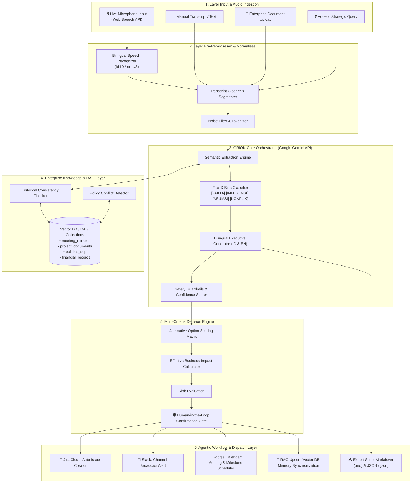

# 🌌 ORION — Enterprise Decision & Productivity Orchestrator v1.0
> **Platform Orkestrasi Keputusan & Transkrip Rapat Cerdas Berbasis AI (Bilingual ID/EN)**

[](https://react.dev/)
[](https://www.typescriptlang.org/)
[](https://ai.google.dev/)
[](https://tailwindcss.com/)
[](https://vitejs.dev/)
[](LICENSE)

---

## 📖 1. Pengertian ORION

**ORION** (*Enterprise Decision & Productivity Orchestrator*) adalah platform enterprise cerdas generasi baru yang dirancang khusus untuk mentransformasi percakapan rapat, notulen, transkrip rekaman suara langsung, dan dokumen strategis menjadi **keputusan bisnis yang dapat ditindaklanjuti (*actionable decisions*)** dan **tindakan otomatis (*agentic workflows*)**.

### Latar Belakang Masalah
Di lingkungan korporat dan pemerintahan modern, organisasi sering mengalami:
1. **Meeting Fatigue & Information Loss**: Rapat panjang menghasilkan ratusan kalimat, namun poin keputusan dan PIC sering terlewat atau tidak tercatat rapi.
2. **Ambiguitas Fakta vs Asumsi**: Sering terjadi bias saat diskusi, di mana opini dan asumsi pribadi dianggap sebagai fakta riil bisnis tanpa data pendukung.
3. **Ketidakkonsistenan dengan Riwayat/Regulasi (RAG)**: Keputusan sering bertentangan dengan kebijakan lama, SLA, atau anggaran Q sebelumnya karena peserta tidak mengingat arsip historis.
4. **Hambatan Bahasa (Bilingual Meeting)**: Diskusi tingkat enterprise di Asia Tenggara sering menggabungkan Bahasa Indonesia dan Bahasa Inggris secara simultan (*code-switching*).
5. **Eksekusi Tertunda**: Notulen selesai, namun pembuatan tiket Jira, pengumuman Slack, dan reservasi kalender memakan waktu berhari-hari.

### Solusi ORION
ORION hadir sebagai **orkestrator sentral** dengan filosofi:
- **Zero-Hallucination Guardrail**: Memberi label eksplisit pada setiap poin: `[FAKTA]`, `[INFERENSI]`, `[ASUMSI]`, atau `[KONFLIK]`.
- **Dukungan Bilingual Penuh (ID/EN)**: Mampu mendengar, mentranskripsikan, menganalisis, dan menghasilkan dokumen bilingual secara instan.
- **Decision Engine Terstruktur**: Menyusun matriks perbandingan opsi keputusan lengkap dengan kalkulasi dampak, risiko, skor prioritas, serta gerbang konfirmasi manusia (*Human-in-the-Loop*).
- **Agentic Dispatching**: Mengonversi butir tindakan secara otomatis ke dalam format payload API siap pakai (Jira Ticket, Slack Alert, Google Calendar, dan RAG Upsert).

---

## 🛠️ 2. Teknologi yang Digunakan (Tech Stack)

ORION dibangun menggunakan arsitektur modern berkinerja tinggi, ringan, dan aman:

| Kategori | Teknologi | Deskripsi / Peran dalam Sistem |
| :--- | :--- | :--- |
| **AI & LLM Engine** | **Google Gemini API (`@google/genai` v2.4+)** | Pemrosesan bahasa alami berkemampuan tinggi, penalaran kontekstual, ekstraksi entitas, deteksi risiko, dan pembangkitan teks bilingual. |
| **Speech-to-Text** | **Web Speech API (`webkitSpeechRecognition`)** | Perekaman suara rapat secara langsung (*real-time live recording*) dengan dukungan transkripsi kontinyu dan dual-recognition (`id-ID` & `en-US`). |
| **Frontend Framework** | **React 19 (Hooks & Functional)** | UI reaktif, modular, responsif terhadap viewport layar lebar monitor (*no-vertical-scroll layout*). |
| **Bahasa Pemrograman**| **TypeScript 7 / 5.x** | *Type safety* penuh dari skema ekstraksi, struktur payload agentic, hingga model data keputusan. |
| **Build Tool & Bundler**| **Vite 8** | *Hot Module Replacement* super cepat, kompilasi efisien, dan integrasi bundler optimal. |
| **Styling & Theme** | **Tailwind CSS v4 + Canvas Particle API** | Desain bertema *Cyber-Enterprise Constellation* (Dark Cyan / Deep Navy / Slate) dengan animasi jaringan bintang interaktif. |
| **Komponen UI & Ikon** | **Lucide React & Motion** | Ikonografi modern, transisi visual halus, visualisasi meteran skor dan status badge. |
| **RAG & Vector Simulator**| **Semantic Cosine Search Engine** | Modul pencarian kemiripan vektor (*vector similarity*) untuk memvalidasi konsistensi dokumen terhadap basis pengetahuan internal. |
| **Ekspor Dokumen** | **Markdown & JSON Exporter** | Fitur 1-klik unduh notulen rapat berformat Markdown (`.md`) dan payload teknis (`.json`). |

---

## 🏗️ 3. Diagram Arsitektur Sistem

### 3.1 Diagram Arsitektur End-to-End (Mermaid)



---

### 3.2 Diagram Alur Data & Logika Eksekusi (Sequence Overview)

```
[ Pengguna / Rapat ]
       │
       ▼ (1) Suara Rapat / Teks Dokumen
[ Input View & Web Speech API ]
       │
       ▼ (2) Transkrip Bersih + Bilingual Tags
[ ORION Analyzer Service ]
       ├── (3A) Query RAG History ──> [ Vector Knowledge Base ]
       │                                       │ (Konteks Historis & SOP)
       │                                       ▼
       ├── (3B) Prompt Orchestration ──> [ Google Gemini API ]
       │                                       │ (Ekstraksi, Klasifikasi Fakta, Sintesis)
       │                                       ▼
       ├── (4) Evaluasi Bobot & Dampak ──> [ Decision Matrix Engine ]
       │
       ▼ (5) Hasil Analisis Terpadu
┌────────────────────────────────────────────────────────┐
│  • Dashboard: Ringkasan & Pending Tasks                │
│  • Output View: Bilingual MoM & Executive Summary      │
│  • Extraction View: Tabel Filter [FAKTA]/[ASUMSI]       │
│  • Decision View: Matriks Opsi & Gerbang Konfirmasi    │
│  • Action Plan View: Disparitas Tiket & Notifikasi     │
└────────────────────────────────────────────────────────┘
       │
       ▼ (6) Eksekusi / Dispatch Terkonfirmasi
[ Jira / Slack / Google Calendar / File Download ]
```

---

## ✨ 4. Fitur-Fitur Utama ORION

### 🎙️ 1. Perekaman Suara Rapat Langsung (Live Audio Recording)
- Menggunakan browser native **Web Speech API** dengan parameter `continuous = true` dan `interimResults = true`.
- Mendukung rapat dwibahasa (Bahasa Indonesia & Bahasa Inggris).
- Tombol intuitif: `🎙️ Start Recording / Mulai Rekam` dan `🛑 Stop Recording / Hentikan Rekaman` lengkap dengan indikator *listening pulse*.

### 🏷️ 2. Klasifikasi Ketat Fakta vs Asumsi (*No-Hallucination*)
Setiap butir temuan dikategorikan ke dalam taksonomi baku:
- **`[FAKTA]`**: Pernyataan berlandaskan data metrik, angka terukur, atau dokumen resmi.
- **`[INFERENSI]`**: Kesimpulan logis dari beberapa fakta gabungan.
- **`[ASUMSI]`**: Dugaan atau hipotesis kerja yang membutuhkan validasi lebih lanjut.
- **`[KONFLIK]`**: Pernyataan yang kontradiktif dengan data historis atau SOP organisasi.

### 📊 3. Matriks Keputusan Multi-Kriteria (*Decision Matrix*)
- Membandingkan opsi alternatif berdasarkan **Business Impact**, **Risiko**, **Tingkat Upaya (Effort)**, dan **Skor Kelayakan (0–100)**.
- Menyediakan rekomendasi opsi terpilih disertai prasyarat (*prerequisites*).
- Dilengkapi fitur **Human-in-the-Loop**: Perubahan status keputusan penting mewajibkan persetujuan manual administrator.

### ⚡ 4. Agentic Workflow & Multi-System Dispatcher
- Mengonversi *Action Items* langsung menjadi paket tindakan integrasi:
  - **TICKET_CREATE**: Pembuatan issue Jira / ClickUp dengan PIC, prioritas P0-P3, dan deadline.
  - **SLACK_NOTIFY**: Penyusunan format notifikasi channel tim lengkap dengan ringkasan eksekutif.
  - **CALENDAR_INVITE**: Penjadwalan tindak lanjut review proyek.
  - **RAG_UPSERT**: Penyimpanan hasil rapat ke memori vektor jangka panjang.

### 📚 5. Basis Pengetahuan & Simulasi RAG (Retrieval-Augmented Generation)
- Memeriksa konsistensi hasil diskusi dengan 4 korpus data utama: *Meeting Minutes*, *Project Docs*, *Policies & SOP*, serta *Financial Records*.
- *Vector Search Playground* untuk menguji kemiripan semantik query terhadap dokumen terindeks.

---

## 📂 5. Struktur Direktori Proyek

```
orion-orchestrator/
├── .env.example              # Template variabel lingkungan (GEMINI_API_KEY)
├── index.html                # Entry point HTML & font typography
├── metadata.json             # Konfigurasi perizinan mikrofon & Gemini API
├── package.json              # Daftar pustaka & dependensi proyek
├── tsconfig.json             # Konfigurasi compiler TypeScript
├── vite.config.ts            # Konfigurasi bundler Vite & Tailwind 4
├── src/
│   ├── main.tsx              # Bootstrap React application
│   ├── App.tsx               # State router, modal orchestration, & global view state
│   ├── index.css             # Tailwind 4 theme, design tokens, & neon effects
│   ├── types/
│   │   └── orion.ts          # TypeScript interfaces (Extraction, Matrix, Agentic Actions)
│   ├── services/
│   │   └── analyzer.ts       # Mesin orkestrator analisis, integrasi Gemini, & fallback
│   ├── data/
│   │   └── sampleScenarios.ts# Dataset uji enterprise (Budget Review, Cloud Outage, dll)
│   └── components/
│       ├── ConstellationCanvas.tsx # Ambient canvas network particle visualizer
│       ├── Sidebar.tsx             # Navigasi utama dengan 8 tampilan kerja
│       ├── TopBar.tsx              # Breadcrumbs, bilingual switcher, status indikator
│       ├── modals/
│       │   ├── ActionDetailModal.tsx # Simulasi inspeksi payload Jira/Slack
│       │   └── ExportModal.tsx       # Modal unduh notulen (Markdown / JSON)
│       └── views/
│           ├── DashboardView.tsx     # KPI metrik, aktivitas terkini, & tugas tertunda
│           ├── InputView.tsx         # Input tab (Transcript, Mic Voice, Document, Query)
│           ├── OutputView.tsx        # Notulen lengkap Template A, B, C, & E
│           ├── ExtractionView.tsx    # Tabel granular fakta & kategori filter
│           ├── DecisionView.tsx      # Matriks skor keputusan & gerbang konfirmasi
│           ├── ActionPlanView.tsx    # Timeline tindakan agen & simulasi kirim
│           ├── KnowledgeView.tsx     # Pengujian RAG & manajemen korpus vektor
│           └── SettingsView.tsx      # Konfigurasi guardrails, webhook, & preferensi
└── README.md                 # Dokumentasi resmi proyek
```

---

## 🚀 6. Panduan Instalasi & Menjalankan Aplikasi

### Prasyarat Sistem
- **Node.js**: v18.0.0 atau yang lebih baru
- **NPM** atau **Bun** / **Yarn**
- **Browser Modern**: Google Chrome, Microsoft Edge, atau Safari (disarankan Chrome untuk dukungan penuh Web Speech API)
- **API Key Google Gemini** *(opsional jika menggunakan mode evaluasi demo offline)*

### Langkah Instalasi

1. **Clone Repositori**:
   ```bash
   git clone https://github.com/username/orion-orchestrator.git
   cd orion-orchestrator
   ```

2. **Pasang Dependensi**:
   ```bash
   npm install
   ```

3. **Konfigurasi Environment Variable**:
   Salin file `.env.example` menjadi `.env.local` dan masukkan kunci API Gemini Anda:
   ```bash
   cp .env.example .env.local
   ```
   Isi file `.env.local`:
   ```env
   GEMINI_API_KEY=AIzaSyYourActualGoogleGeminiKeyHere
   ```

4. **Jalankan Development Server**:
   ```bash
   npm run dev
   ```
   Buka browser di alamat: `http://localhost:3000`

5. **Build untuk Produksi**:
   ```bash
   npm run build
   ```
   Hasil build siap saji akan berada di direktori `dist/`.

---

## 🔒 7. Standar Keamanan & Etika Data

- **Zero Data Leakage**: Transkripsi audio diproses langsung di sisi klien melalui Web Speech API peramban tanpa perantara server pihak ketiga yang tidak berizin.
- **Explicit Human Gate**: Tindakan berprioritas kritis (P0/P1) pada sistem eksternal (Jira/Slack/DB) tidak akan dieksekusi secara otonom tanpa verifikasi dari admin pengguna.
- **Bilingual Veracity**: Setiap ringkasan mempertahankan konteks asli pernyataan pembicara tanpa mengubah substansi fakta bisnis.

---

## 📄 8. Lisensi

Proyek ini dirilis di bawah lisensi **MIT License**. Silakan gunakan, kembangkan, dan integrasikan untuk kebutuhan riset, enterprise, maupun komunitas.
